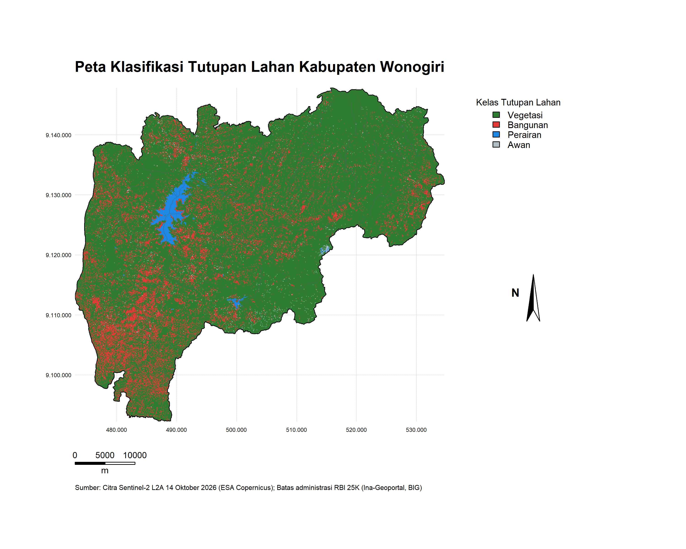

<div align="center">
  
  # Klasifikasi Tutupan Lahan Kabupaten Wonogiri
  
  **Indeks spektral Sentinel-2 L2A, klasifikasi berbasis threshold, statistik zonal per kecamatan, dan WebGIS interaktif (R Shiny + Leaflet)**
  
  [](https://adambudi.shinyapps.io/tutupan-lahan-wonogiri/)


Tugas Besar ETS, Pemrograman Spasial A
Teknik Geomatika, Institut Teknologi Sepuluh Nopember (ITS)

</div>
  
  ---
  
  ## Dashboard Online
  
  Dashboard dapat dibuka siapa saja melalui browser, tanpa instalasi apa pun:
  
  ### [Tutupan Lahan](https://adambudi.shinyapps.io/tutupan-lahan-wonogiri/)
  
  ```
https://adambudi.shinyapps.io/tutupan-lahan-wonogiri/
  ```

> Dashboard di-host di shinyapps.io (paket gratis). Jika aplikasi sedang tidak aktif, halaman butuh sekitar 10 sampai 20 detik untuk menyala kembali. Tunggu sampai tampilan muncul.

---
  
  ## Latar Belakang dan Tujuan
  
  Informasi tutupan lahan dibutuhkan untuk perencanaan wilayah, pemantauan lingkungan, dan pengelolaan sumber daya. Citra Sentinel-2 menyediakan data multispektral beresolusi 10 sampai 20 m yang gratis dan terbuka, sehingga cocok untuk memetakan tutupan lahan tingkat kabupaten.

Tujuan proyek ini:
  
  1. Menghitung indeks spektral **NDVI, NDBI, NDWI, dan NDCI** dari citra Sentinel-2 L2A untuk Kabupaten Wonogiri.
2. Mengklasifikasikan tutupan lahan menjadi **vegetasi, bangunan, perairan, dan awan** dengan metode threshold.
3. Menghitung **statistik zonal** setiap indeks dan **luas tiap kelas** per kecamatan.
4. Menyajikan hasil dalam **peta cetak** (layout) dan **dashboard interaktif** yang dapat diakses publik.

---
  
  ## Data yang Digunakan
  
  | Data | Keterangan | Sumber |
  |---|---|---|
  | Citra Sentinel-2 L2A | Band B03, B04, B05, B08, B11 (reflektansi permukaan terkoreksi atmosfer) | Copernicus Data Space Ecosystem |
  | Batas administrasi | RBI 25K 2022 (batas kabupaten dan kecamatan) | BIG melalui Ina-Geoportal |
  | Peta dasar dashboard | OpenStreetMap dan Esri World Imagery | Leaflet providers |
  
  Sistem koordinat analisis: **UTM Zona 49S (EPSG:32749)**.

---
  
  ## Alur Kerja
  
  ```
Citra Sentinel-2 L2A  +  Batas RBI 25K
│
▼
Pemotongan ke Kabupaten Wonogiri
│
▼
Konversi ke reflektansi (DN - 1000) / 10000
│
▼
Hitung indeks: NDVI, NDBI, NDWI, NDCI
│
▼
Klasifikasi threshold (vegetasi, bangunan, perairan, awan)
│
▼
Statistik zonal per kecamatan (indeks + luas kelas)
│
├──► Tabel (CSV dan Word)
├──► Peta layout (QGIS dan R)
└──► Dashboard Shiny + Leaflet (shinyapps.io)
```

---
  
  ## Metode
  
  ### 1. Pra-pemrosesan
  
  Nilai piksel Sentinel-2 L2A dikonversi menjadi reflektansi permukaan:
  
  ```
reflektansi = (DN - 1000) / 10000      (nilai negatif dibatasi menjadi 0)
```

Seluruh band dipotong sesuai batas Kabupaten Wonogiri dan diproyeksikan ke UTM 49S.

### 2. Indeks Spektral

| Indeks | Rumus | Kegunaan |
  |---|---|---|
  | NDVI | (B08 - B04) / (B08 + B04) | Kerapatan vegetasi |
  | NDBI | (B11 - B08) / (B11 + B08) | Lahan terbangun |
  | NDWI | (B03 - B08) / (B03 + B08) | Badan air |
  | NDCI | (B05 - B04) / (B05 + B04) | Deteksi awan |
  
  ### 3. Klasifikasi Threshold
  
  Aturan diterapkan berurutan. Aturan yang lebih akhir menimpa aturan sebelumnya.

| Urutan | Kelas | Aturan |
  |---|---|---|
  | 1 | Vegetasi | NDVI >= 0,30 |
  | 2 | Bangunan | NDBI > 0,15 |
  | 3 | Perairan | NDWI > 0 |
  | 4 | Awan | NDCI <= 0,03 **dan** reflektansi band merah >= 0,20 |
  
  ### 4. Statistik Zonal
  
  Untuk setiap kecamatan dihitung rata-rata, minimum, maksimum, median, dan standar deviasi tiap indeks. Luas (km²) dan persentase tiap kelas tutupan lahan dihitung dari raster klasifikasi.

---
  
  ## Hasil
  
  ### Proporsi tutupan lahan Kabupaten Wonogiri
  
  | Kelas | Proporsi |
  |---|---|
  | Vegetasi | 83,74 % |
  | Bangunan | 13,93 % |
  | Perairan | 1,50 % |
  | Awan | 0,83 % |
  
  ### Temuan utama
  
  - Wilayah analisis mencakup **25 kecamatan**.
- NDVI rata-rata tertinggi: **Kecamatan Jatipurno (0,610)**.
- NDVI rata-rata terendah: **Kecamatan Baturetno (0,334)**.
- Vegetasi mendominasi wilayah kabupaten.

Tabel lengkap tersedia di folder `output/`:
  
  | File | Isi |
  |---|---|
  | `zonal_statistics_kecamatan.csv` | Statistik zonal indeks per kecamatan |
  | `luas_kelas_kecamatan.csv` | Luas dan persentase kelas per kecamatan |
  
  ---
  
  ## Peta
  
  ### Peta layout (QGIS)
  
  

### Peta klasifikasi (R)



Kelengkapan peta: judul, legenda, skala (meter), panah utara, grid koordinat UTM 49S, dan sumber data.

---
  
  ## Fitur Dashboard
  
  Dashboard dibangun dengan **R Shiny**, **shinydashboard**, dan **Leaflet**. Semua data dibaca dari folder `output/`.

| Menu | Isi |
  |---|---|
  | **Tutupan Lahan** | Peta klasifikasi interaktif. Tiap kelas bisa dinyalakan atau dimatikan, ada pilihan peta dasar (OpenStreetMap, Citra Satelit), batas kabupaten dan kecamatan, nama kecamatan, legenda, dan popup statistik saat kecamatan diklik |
  | **Zonal Indeks per Kecamatan** | Peta tematik rata-rata NDVI, NDBI, NDWI, dan NDCI per kecamatan |
  | **Statistik per Kecamatan** | Tabel luas kelas, tabel zonal statistics per indeks, histogram nilai indeks, dan grafik rata-rata indeks per kecamatan |
  | **Luas Kelas per Kecamatan** | Tabel luas dan persentase kelas per kecamatan serta grafik komposisi tutupan lahan |
  
  > Agar ringan di server gratis, peta klasifikasi pada dashboard online ditampilkan pada resolusi 100 m. Perhitungan statistik tetap memakai hasil analisis penuh.

---
  
  ## Struktur Repository
  
  ```
Tutupan lahan/
  ├── Klasifikasi tutupan lahan.R    # Script analisis: indeks, klasifikasi, zonal, tabel
├── WebGIS.R                       # Script dashboard Shiny (sumber utama)
├── app.R                          # Salinan WebGIS.R untuk deploy ke shinyapps.io
├── Tutupan lahan.Rproj            # Project RStudio
├── output/
  │   ├── kecamatan_wonogiri.shp     # Batas kecamatan (beserta file pendamping)
│   ├── kabupaten_wonogiri.shp     # Batas kabupaten
│   ├── zonal_statistics_kecamatan.csv
│   ├── luas_kelas_kecamatan.csv
│   ├── klasifikasi_50m.tif        # Raster klasifikasi resolusi 50 m
│   ├── indeks/                    # Raster indeks (untuk histogram dashboard)
  │   ├── peta_layout_qgis.png
│   └── peta_klasifikasi_layout.png
├── README.md
└── .gitignore
```

> Citra Sentinel-2 mentah dan raster beresolusi penuh tidak diunggah ke repository karena melebihi batas ukuran file GitHub (100 MB).

---
  
  ## Cara Menjalankan
  
  ### Opsi 1: Buka dashboard online
  
  Klik: **https://adambudi.shinyapps.io/tutupan-lahan-wonogiri/**
  
  ### Opsi 2: Jalankan dashboard di komputer sendiri
  
  1. Clone repository:
  ```bash
git clone https://github.com/adambudi/Tugas-Besar-ETS-Pemrograman-Spasial.git
```
2. Buka folder hasil clone di RStudio.
3. Pasang paket yang dibutuhkan:
  ```r
install.packages(c("shiny", "shinydashboard", "leaflet", "leaflet.extras",
                   "raster", "sf"))
```
4. Jalankan:
  ```r
shiny::runApp("WebGIS.R")
```

Pastikan folder `output/` berada di folder yang sama dengan `WebGIS.R`.

### Opsi 3: Ulangi seluruh analisis

1. Unduh citra Sentinel-2 L2A area Wonogiri dari Copernicus Data Space Ecosystem dan batas RBI 25K dari Ina-Geoportal.
2. Atur path data di bagian awal `Klasifikasi tutupan lahan.R`.
3. Jalankan script dari atas ke bawah. Hasil tersimpan di folder `output/`.

### Deploy ulang ke shinyapps.io (opsional)

```r
file.copy("WebGIS.R", "app.R", overwrite = TRUE)
files <- c("app.R", list.files("output", recursive = TRUE, full.names = TRUE))
files <- files[!grepl("^output/band|^output/web|\\.docx$|\\.png$", files)]
rsconnect::deployApp(appFiles = files, appName = "tutupan-lahan-wonogiri")
```

---
  
  ## Keterbatasan
  
  - Klasifikasi memakai **threshold tetap** (tanpa training data), sehingga kelas yang spektralnya mirip, misalnya lahan terbuka dan bangunan, dapat tertukar.
- Kelas **awan** dideteksi dari satu tanggal akuisisi dan bayangan awan tidak diklasifikasikan khusus.
- Belum ada **uji akurasi** terhadap data referensi lapangan.
- Dashboard online memakai resolusi peta klasifikasi yang diturunkan (100 m) karena batas memori paket gratis.

---
  
  ## Sumber Data dan Atribusi
  
  - Contains modified Copernicus Sentinel data (2026), diunduh dari Copernicus Data Space Ecosystem.
- Batas administrasi: RBI 25K 2022, Badan Informasi Geospasial (BIG), melalui Ina-Geoportal.
- Peta dasar dashboard: © OpenStreetMap contributors dan Esri World Imagery.

---
  
  ## Anggota Kelompok
  
  | Nama | Program Studi |
  |---|---|
  | Adam Budi Kusumo | 5016241135 |
  | Alif Putra Dewangga | 5016241121 |
  
  Mata kuliah: Pemrograman Spasial A